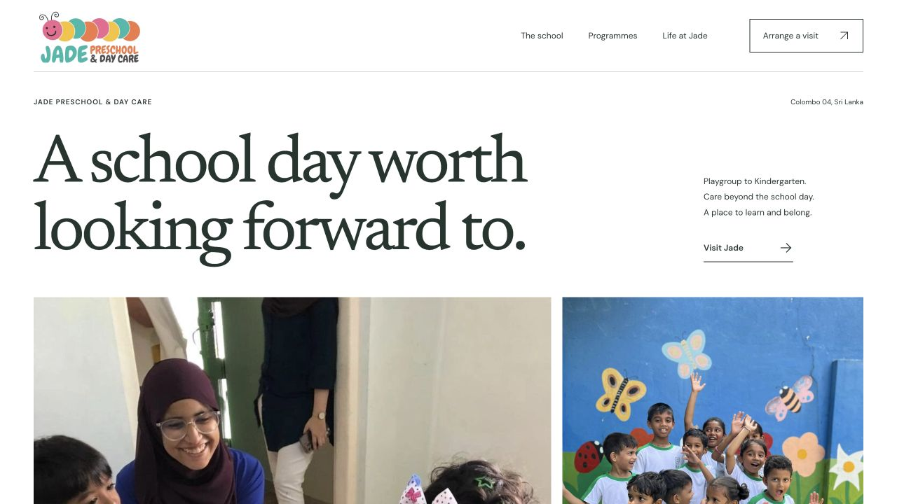

# Jade Preschool & Day Care

A complete, independent website concept for Jade Preschool and Daycare in Colombo. Built around real school photography, a clear parent journey and an original editorial identity.

**[View the prototype](https://dion-nikila.github.io/jade-preschool/)** · **[Research and design rationale](docs/RESEARCH.md)**



## Six pages, one considered experience

- **Home:** a memorable introduction and clear routes into the school.
- **Our approach:** the thinking behind learning through play.
- **Programmes:** Playgroup, Nursery, Kindergarten and Day Care, with individual enquiry links.
- **Life at Jade:** a photographic look around the school, with an accessible photo viewer.
- **Visit & admissions:** practical FAQs and an enquiry composer.
- **Privacy & credits:** honest information about the independent concept, data handling and photography.

The enquiry composer validates entries, prepares a message and lets the parent review it before opening WhatsApp. It does not send a message, save personal data or book an appointment on its own.

## Run locally

Requires Node.js 20 or newer. There are no package dependencies or installation steps.

```sh
npm run build
npm run dev
```

Open the printed local address, normally `http://127.0.0.1:4173/`.

```sh
npm test
```

Builds every page and checks local links, fragment targets, image references, font files, unique IDs, page titles, descriptions and accessibility foundations.

## Source layout

```text
assets/                 Local fonts, original CSS/JS, icons and school photographs
scripts/build.mjs       Shared layouts and static HTML generation
scripts/content.mjs     Programmes, leadership and admissions information
scripts/check.mjs       Generated-site validation
scripts/serve.mjs       Dependency-free local preview server
docs/RESEARCH.md        Sources, competitive observations and design rationale
docs/QA.md              Browser checks and known limits
docs/image-credits.json Original photography sources
.github/workflows/      Automatic checks and GitHub Pages publishing
```

`dist/` is generated. The build is portable to any static hosting provider; links work beneath the GitHub Pages project prefix as well as on a root domain. The 404 page points back to the public prototype so nested missing URLs retain a working escape route.

## Design

The school’s original logo, Newsreader display typography, DM Sans body text, rectangular documentary photographs, a white page and an apricot admissions section. Programme listings and practical school information replace decorative cards and slogans. Fonts are self-hosted under the SIL Open Font License. No autoplay carousels, scroll prompts, tracking scripts or animation dependencies.

## Status and rights

This is an independent prototype, not the official Jade website. Contact details and programme descriptions were researched on 27 October 2026; verify current arrangements directly with the school. School photographs retain their original ownership and are included to present this concept; no permission for third-party reuse is granted. See [photography sources](docs/image-credits.json), [research notes](docs/RESEARCH.md), and the [privacy page](https://dion-nikila.github.io/jade-preschool/privacy/).

The prototype is marked `noindex,follow`. Before an official launch, the school should approve its information, brand treatment and photography, and confirm its final domain and admissions process.
